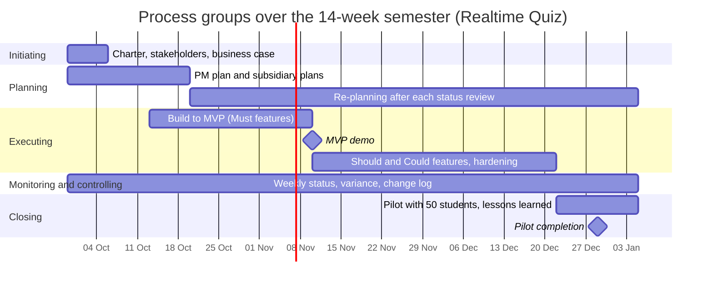

# Process Groups and Phase Gates

| Process group | Weeks active | Main activities | Outputs | Lab that produces them |
|---|---|---|---|---|
| Initiating | 1 | Define purpose, classify project, identify sponsor and stakeholders | Project charter, stakeholder list, business case | Lab 01 |
| Planning | 1-3, 4-14 | PM plan, WBS, schedule, budget, risk planning, and ongoing re-planning | PM plan, subsidiary plans, updated schedules | Labs 02, 03, 04 |
| Executing | 4-13 | Building the software (Must, Should, Could features), hardening | Code, MVP demo, release candidates | Practice (Coding) |
| Monitoring and controlling | 1-14 | Weekly status meeting, schedule and cost variance, risk review, change requests | Status reports, change log, updated baselines | Labs 05, 06, 09, every lab |
| Closing | 13-14 | Pilot with 50 students, runbook handover, lessons learned | Final product pilot, lessons learned document | Lab 12 |

## Process groups over the semester

### Phase Gates
- Gate 1 (Week 1 - Charter Approval): The sponsor signs the charter, establishing the project's continued business justification and authorizing the team to start planning.

- Gate 2 (Week 7 - MVP Demo): The sponsor evaluates the live MVP demo. Evidence needed: all Must features work live without crashing. If it fails, the project switches to buying a SaaS.

- Gate 3 (Week 13 - Pilot Readiness): The project is cleared for the live student pilot. Evidence needed: load test at 100 simulated students is green, data approval received from the DPO, and the runbook is handed to IT operations.